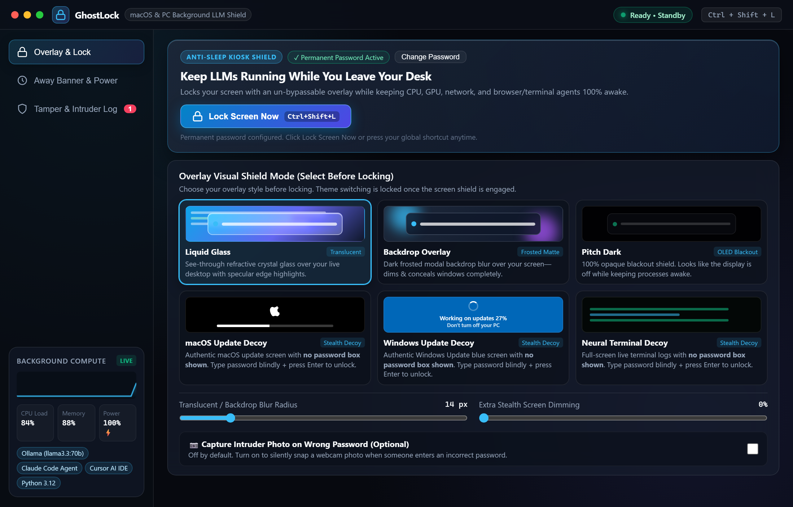
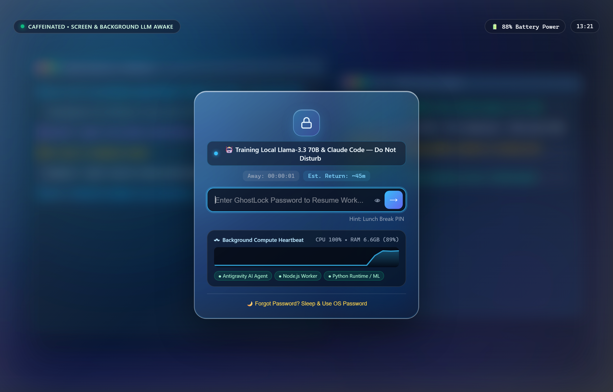
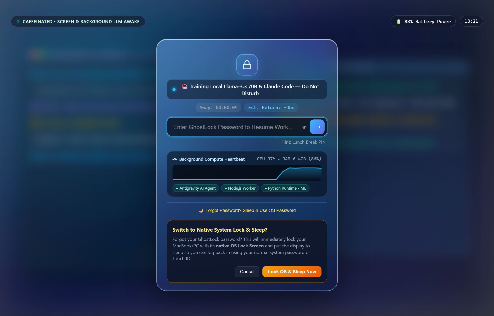
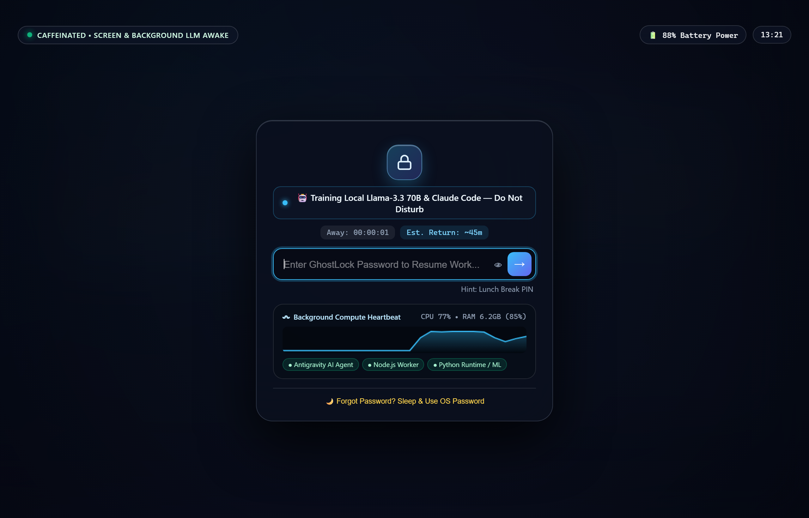
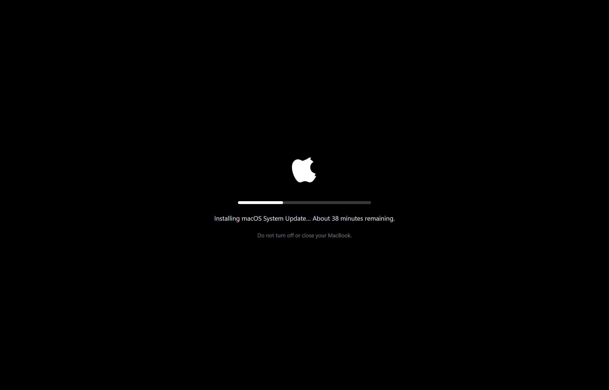
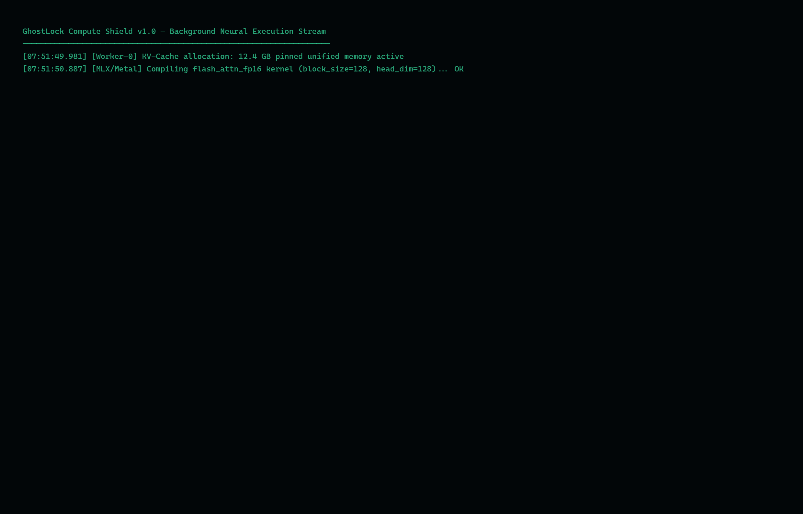
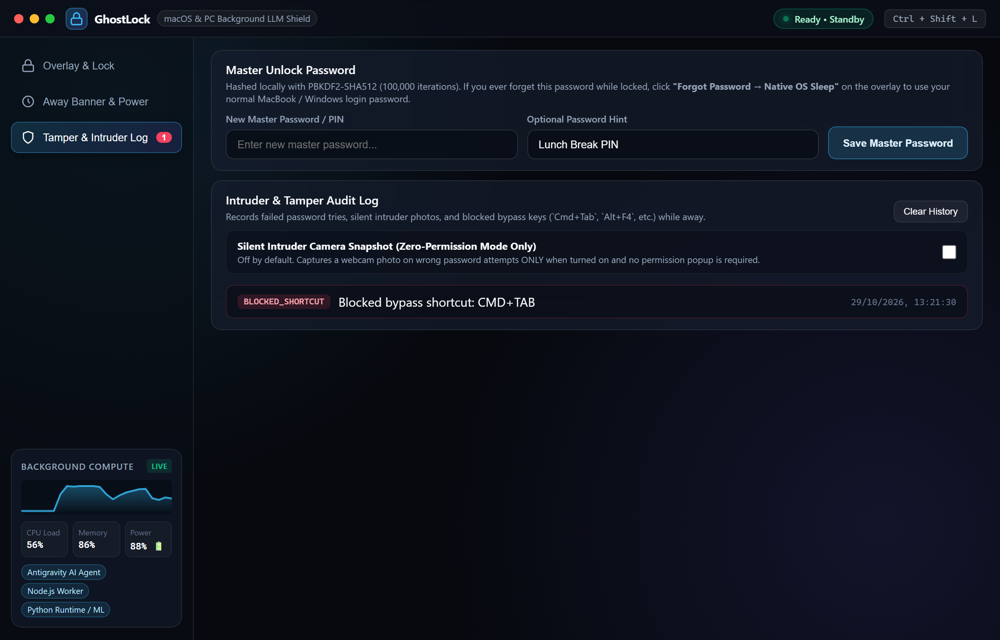

# 🔒 GhostLock — Awake Screen Lock Shield for Background LLMs

[](https://github.com/Bhavya-gupta127/homebrew-ghostlock)
[-emerald?style=flat-square)](https://github.com/Bhavya-gupta127/homebrew-ghostlock)
[](https://github.com/Bhavya-gupta127/homebrew-ghostlock)
[](https://github.com/Bhavya-gupta127/homebrew-ghostlock)
[](https://github.com/Bhavya-gupta127/homebrew-ghostlock)

Keep your **MacBook** or **PC** awake at 100% compute speed so local LLMs (`Ollama`, `llama.cpp`, `MLX`, `vLLM`), coding agents (`Claude Code`, `Cursor`, `Antigravity`), and long-running builds keep executing while you step away from your desk—protected by a **Translucent Liquid Glass**, **Frosted Backdrop**, **Obsidian Pitch Dark**, or **Stealth OS Update Decoy** overlay.

---

## 📸 Visual Showcase

### 1. Control Center Dashboard
Set your permanent password, choose from 6 visual lock & decoy themes, monitor live CPU/RAM telemetry with sparkline history, and inspect detected background AI workloads:

<p align="center">
  
</p>

---

### 2. Translucent Liquid Glass Lock Screen
See-through refractive crystal glass floats over your live desktop with specular edge highlights, an animated aurora ambient glow, an elapsed away timer, a live background compute sparkline, and an un-bypassable password prompt:

<p align="center">
  
</p>

---

### 3. "Forgot Password? Sleep & Use OS Password" Safety Fallback
Zero risk of getting locked out. If you ever forget your GhostLock PIN, click the fallback option to instantly engage the native macOS Lock Screen and put the display to sleep (`Cmd+Ctrl+Q` / `pmset displaysleepnow`). Strangers can never bypass into your desktop, while you can easily log back in using **Touch ID** or your normal Mac password:

<p align="center">
  
</p>

---

### 4. Privacy & Stealth Decoy Modes

Choose the right aesthetic or deception level for your workspace:

#### Frosted Backdrop Blur Mode
Deep matte dark frosted glass concealing all screen contents while maintaining an elegant aesthetic:

<p align="center">
  
</p>

#### Stealth macOS Software Update Decoy
Authentic macOS update screen with a smooth progress bar. **Zero password input box is shown**—passersby assume your Mac is applying system updates. You unlock blindly by typing your password anywhere on the keyboard and pressing `Enter`:

<p align="center">
  
</p>

#### Stealth Neural Compute Terminal Decoy
Streams live synthetic tensor compilation and kernel execution logs over a blacked-out screen with zero visible password boxes:

<p align="center">
  
</p>

---

### 5. Tamper & Intruder Audit Log
Tracks blocked bypass keystrokes (`Cmd+Tab`, `Esc`, `Alt+F4`), failed password attempts, and optional silent webcam snapshot captures taken when an incorrect PIN is entered:

<p align="center">
  
</p>

---

## 📥 Download & Install (macOS & Office MacBooks)

### Option 1: Direct One-Line Install (Recommended — Works on Office Macs with Veltar / Endpoint Security)
Uses only Apple-signed `/usr/bin/curl` and `/usr/bin/tar` (bypasses corporate endpoint restrictions that block Homebrew's Ruby 4.0.0 C extensions):

```bash
curl -fsSL https://raw.githubusercontent.com/Bhavya-gupta127/homebrew-ghostlock/main/install.sh | bash
```

### Option 2: Install via Homebrew Cask / Formula
```bash
brew install --cask Bhavya-gupta127/ghostlock/ghostlock
```

---

## 🚀 Usage & Commands

```bash
# 1. Launch GhostLock Control Center & Fullscreen Kiosk Shield
ghostlock

# 2. Instantly lock the screen from anywhere (or via Cmd+Shift+L global shortcut)
ghostlock lock

# 3. Stop the running GhostLock background daemon
ghostlock stop
```

### First-Time Setup on the Home Screen
1. Run `ghostlock` in your terminal.
2. On the **Home Screen**, enter your **Permanent Unlock Password** and click **Save Password** (`Lock Screen Now` stays disabled until your permanent password is set).
3. *(Optional)* Toggle **📸 Camera Intruder Snapshot** ON if you want webcam snapshots on failed unlock attempts (OFF by default).
4. Click **🔒 Lock Screen Now** or press **`⌘ + ⇧ + L`** anytime to lock!

---

## ✨ Key Features & Architecture

1. **Permanent Password Gate on Home Screen**:
   - Set or change your permanent `PBKDF2-SHA512` (100k iterations) unlock password directly on the Home screen. Locking is disabled until a permanent password is set.
2. **Global Shortcut (`⌘ + ⇧ + L`) & CLI (`ghostlock lock`)**:
   - Works even when the GhostLock window is closed or in the background via the auto-installed macOS Quick Action Service (`~/Library/Services/GhostLock Screen.workflow`) or `ghostlock lock`.
3. **Power Button Sleep / Wake Auto-Dismiss**:
   - If you press the MacBook Power / Touch ID button to sleep your laptop while locked, GhostLock automatically detects native lock state (`CGSSessionScreenIsLocked = <true/>`) and disengages its overlay so you return straight to your normal desktop after authenticating with macOS Touch ID.
4. **Hardware Pointer-Lock Top-Bar Trap & Anti-Hold-Escape Protection**:
   - Locks the macOS hardware pointer away from `y=0` so trackpad movement cannot reveal the macOS menu bar or traffic-light close buttons.
   - Armed with a native borderless `WKWebView` NSWindow shell (`styleMask: [.borderless]`) and instant breach watchdog that terminates and respawns in `<80ms` if Escape is held.
5. **6 Privacy & Stealth Decoy Themes**:
   - **Translucent Liquid Glass (`liquid-glass`)**
   - **Frosted Backdrop Overlay (`backdrop-blur`)**
   - **Obsidian Pitch Dark (`pitch-dark`)**
   - **macOS Software Update Decoy (`decoy-update`)**
   - **Windows 11 Update Decoy (`decoy-win-update`)**
   - **Neural Compute Terminal Decoy (`decoy-terminal`)**
6. **Optional Camera Intruder Snapshot & Accurate Sidebar Badge**:
   - Camera capture is **OFF by default** and can be toggled ON from the Home screen or Tamper Log tab.
   - Failed password attempts are quietly counted on the **Tamper & Intruder Log** sidebar notification badge without cluttering the lock screen or dashboard header.
7. **Live Background Compute Heartbeat**:
   - Safe sparkline waveform on the lock screen displaying real CPU %, Memory %, Power %, and active LLM/dev processes (`Ollama`, `Claude`, `Cursor`, `Python`, `Node.js`) without exposing sensitive desktop text.

---

## 💻 Local Development / Windows Run

```bash
# Zero-Dependency Server Mode
node src/web-preview-server.js

# Full Electron Desktop App
npm install
npm start

# Run Verification Suite
npm test
```
